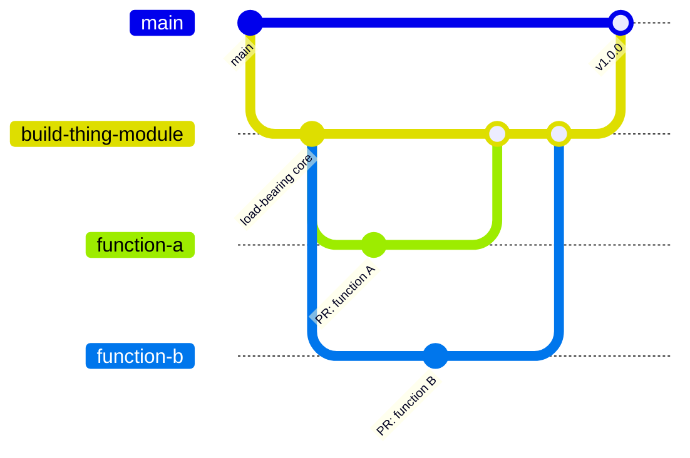

# Module bootstrap

A module's **load-bearing core** contains the components that all other module functions require. The module cannot work without these components.

If the core exceeds one focused feature pull request, use one integration branch for bootstrap.

## Identify the load-bearing core first

Identify the core from the module's archetype in [Module types](../reference/module-types.md):

- **Data modules** - The core is the conversion pivot: `ConvertFrom-<Format>` / `ConvertTo-<Format>` and any parser or serializer they use. Other functions (`Import-`, `Export-`, `Format-`, `Merge-`, ...) depend on this pivot.
- **Integration (API) modules** - The core contains a [`Context`](https://github.com/PSModule/Context)-backed credential and configuration store, its client setup, and at least one API function. That API function uses the context end-to-end. Other API functions depend on the same context and client.

Limit the integration branch to this core, not all features planned for v1. Contributors or agents can develop independent follow-up functions in parallel before the core merges. Start this work only when the core supports those functions.

## Pattern

1. Create one long-lived branch from the default branch for the initial release. Name it for the outcome, for example, `build-thing-module`.
2. Open one pull request per function or small group of related functions. Target the integration branch instead of `main`. Independent pull requests can merge in any order, unlike a [stacked pull request](https://msx.no/docs/Ways-of-Working/Branching-and-Merging/#stacked-pull-requests).
3. When the core is complete and consistent, open the pull request from the integration branch to `main`. The resulting important push produces the module's first release (`v1.0.0`).
4. To include smaller follow-up features before integration, target the same integration branch. Examples include another function, a formatter, or an alias.

## After the core lands

After the core merges as `v1.0.0`, ordinary [SemVer](../reference/versioning.md) applies. A new function on the stable core is a **minor** bump. A fix is a **patch** bump. Only a change to the core's own contract (signature, exported class shape, behavior) is a **major** bump.

Bootstrap has no versioning exception after the core's first release. The bootstrap phase provides the core's initial usable release.

`function-a` and `function-b` are independent. Both start from `build-thing-module` and can merge into it in any order. In a stacked pull request, each layer depends on the preceding layer.

## Example

The example uses one bootstrap integration branch:

| PR | Targets | Contents |
| --- | --- | --- |
| #1 | `main` | `build-thing-module` branch with the load-bearing core, such as a conversion pivot or context, client, and first API function |
| #2 | `build-thing-module` | A follow-up function on the core, added before the integration branch merges |

## When to use this

- Use bootstrap only when the module has no usable release and the load-bearing core has not merged.
- After `main` has a first release, target `main` with ordinary topic branches. Use a [stacked pull request](https://msx.no/docs/Ways-of-Working/Branching-and-Merging/#stacked-pull-requests) only for dependent changes.

For the general branching and merge model, see [MSX Branching and Merging](https://msx.no/docs/Ways-of-Working/Branching-and-Merging/).
